# Anime Atelier

15 оригинальных окружений VWP. Каждая сцена поставляется с анимированными обоями, парной темой и комплектом курсоров. Видео используют неподвижную камеру и 12-секундный повтор; окружение оживляют вода, облака, свет и частицы.

Иллюстрации ниже — постеры. Мастер-видео экспортируются в 3840×2160 / 60 FPS из изображений 1672×941. [Происхождение, промпты и условия](../assets/anime/ARTWORK.md). Обычные видео, темы и курсоры не требуют звезды; проверка относится к трём интерактивным вариантам Afterlight.

## Tsukimi Shrine

Лунный храм. Живая вода, ветер и лепестки сакуры. Курсоры: **Moon Petal**.

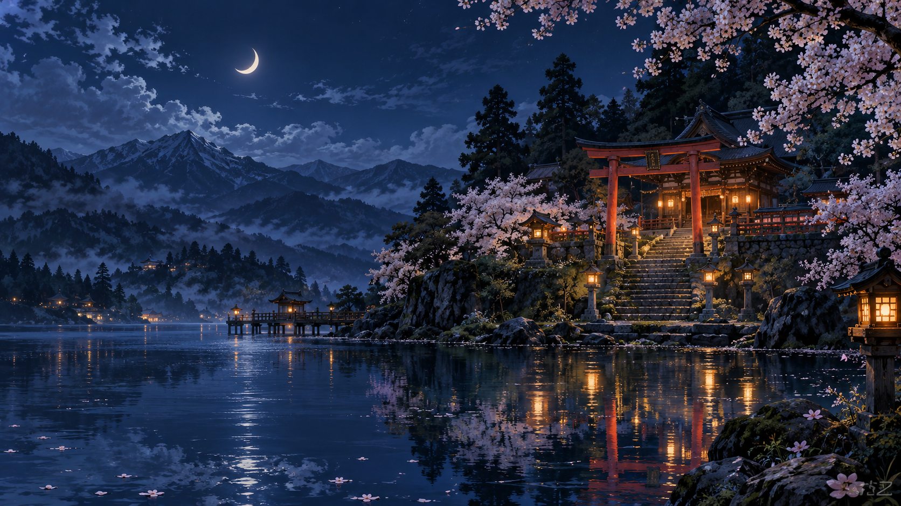

## Neon District

Дождливый неоновый канал. Движущиеся отражения и дождь. Курсоры: **Neon Edge**.

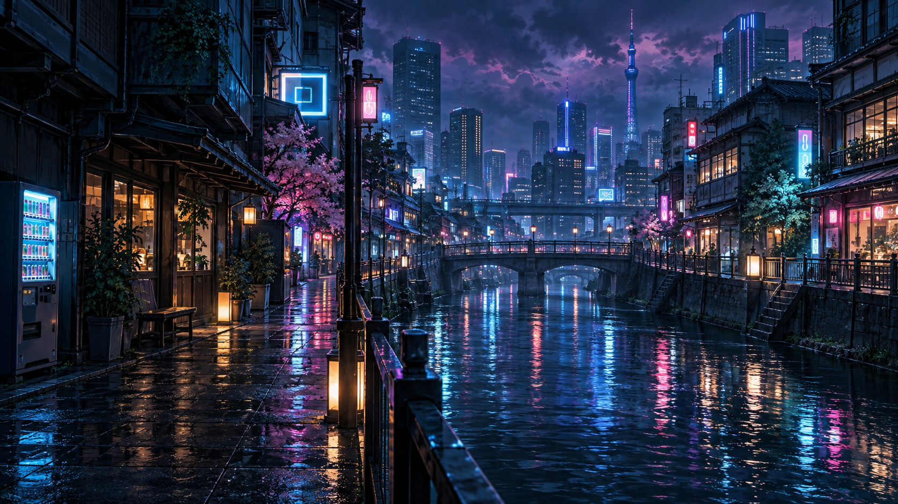

## Quiet Tape

Тёплая лофи-комната. Дождь за окном и мягкий свет. Курсоры: **Tape Ribbon**.

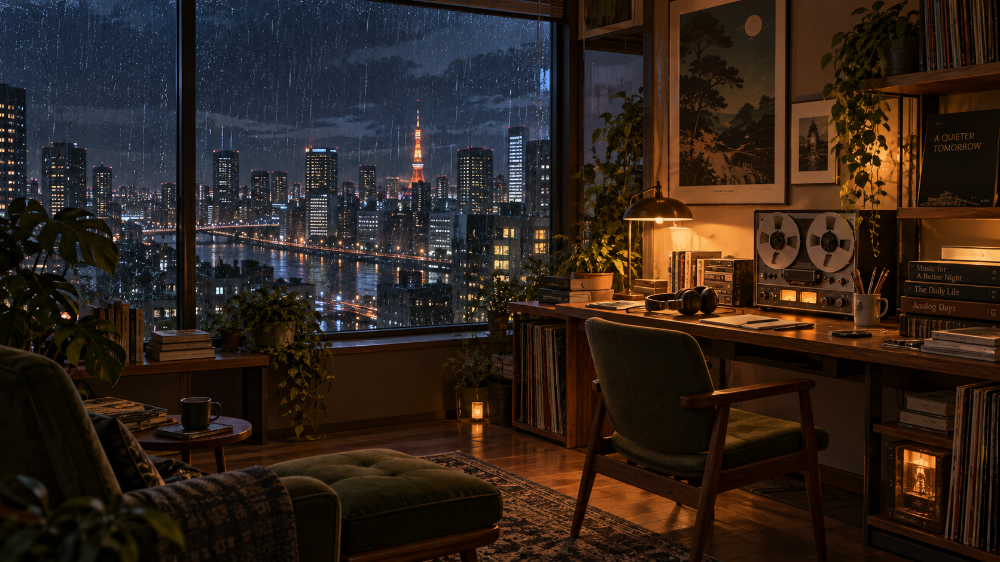

## Astral Greenhouse

Орбитальный сад. Световые потоки, звёзды и вода. Курсоры: **Astral Leaf**.

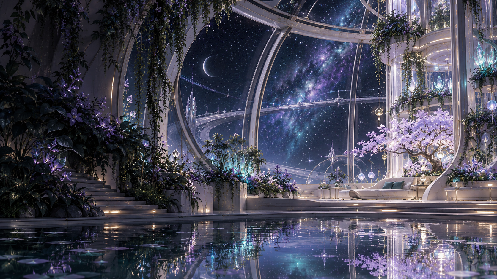

## Blue Hour Platform

Станция в синий час. Ветер, облака и свет платформы. Курсоры: **Rail Signal**.

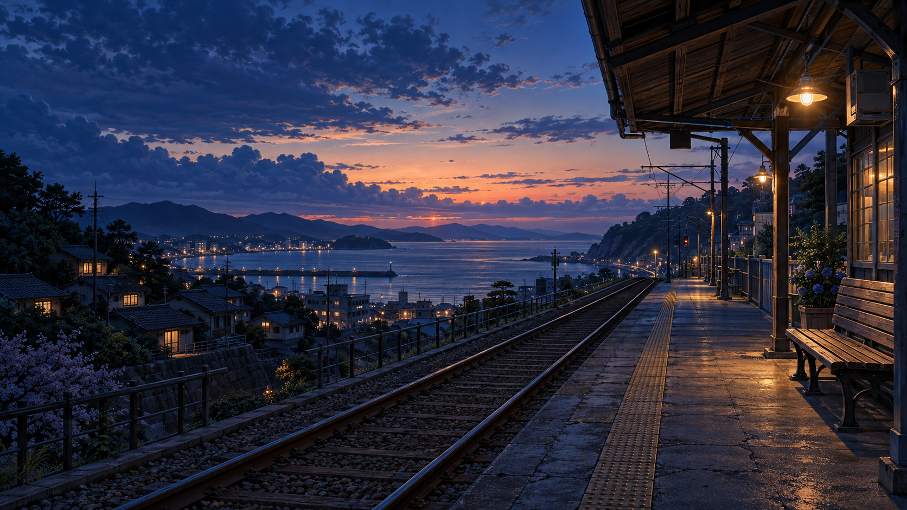

## Kitsune Grove

Зачарованный лес. Светлячки, туман и лунные блики. Курсоры: **Forest Charm**.

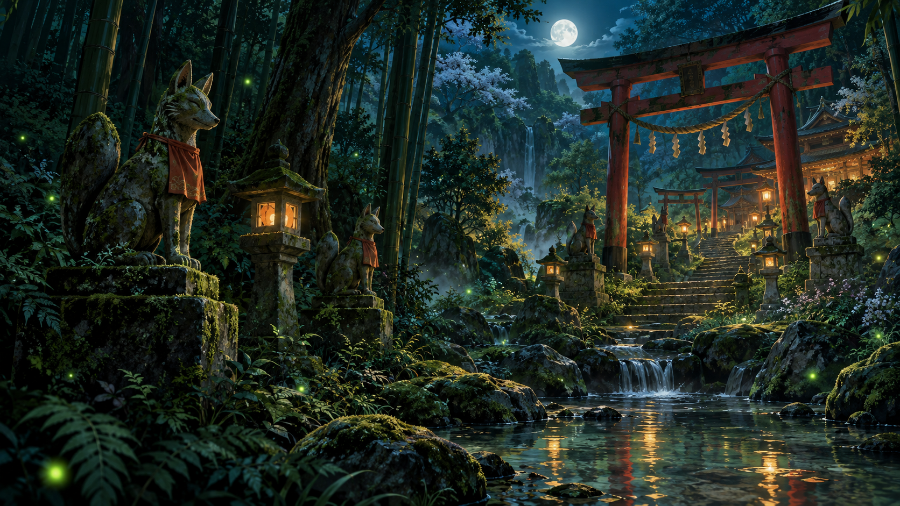

## Summer Afterglow

Японский город на закате. Плывущие облака и летний свет. Курсоры: **Sunset Petal**.

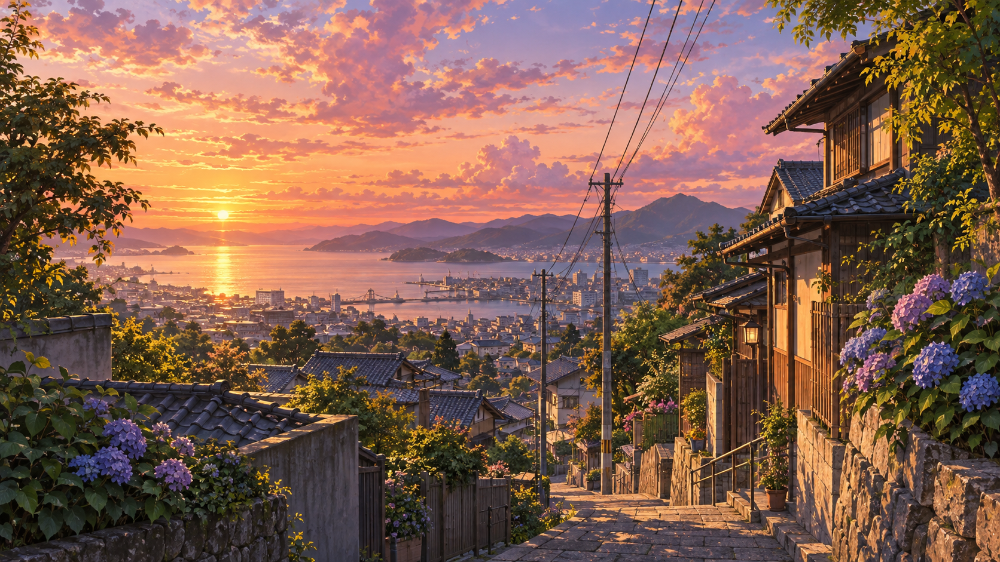

## Tidebound Temple

Храм над океаном. Волны, морской ветер и облака. Курсоры: **Tidal Glass**.

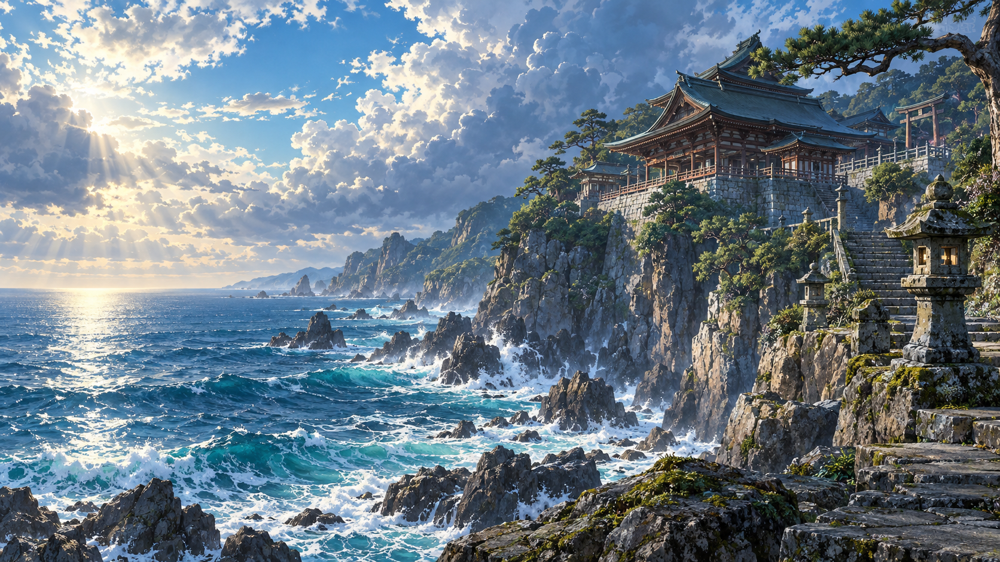

## Scarlet Citadel

Алая цитадель. Искры, ветер и свет фонарей. Курсоры: **Scarlet Katana**.

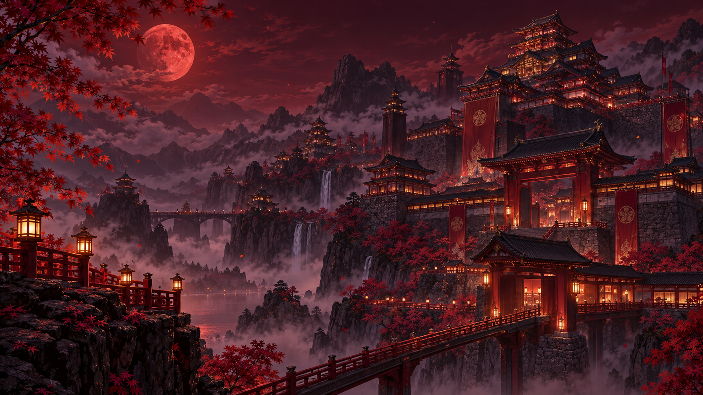

## Snowglass Atelier

Зимняя мастерская. Снег за окном и тёплое освещение. Курсоры: **Snowglass Crystal**.

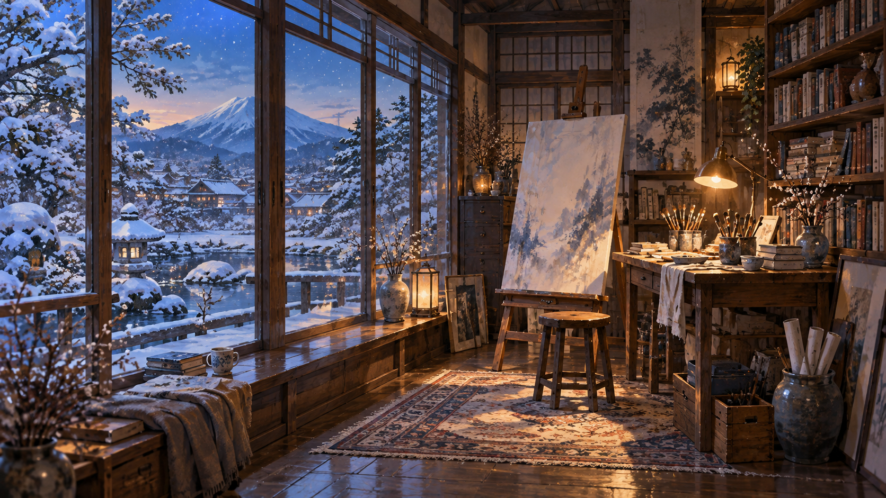

## Violet Sanctuary

Сказочная библиотека. Световая пыль и мягкое сияние. Курсоры: **Violet Sigil**.

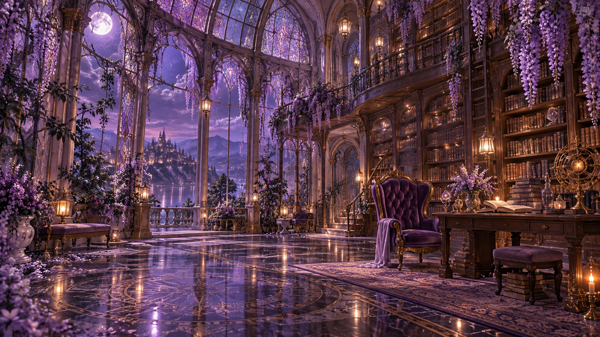

## Aqua Terminal

Подводная станция. Живые каустики, пузырьки и синий свет. Курсоры: **Aqua Prism**.

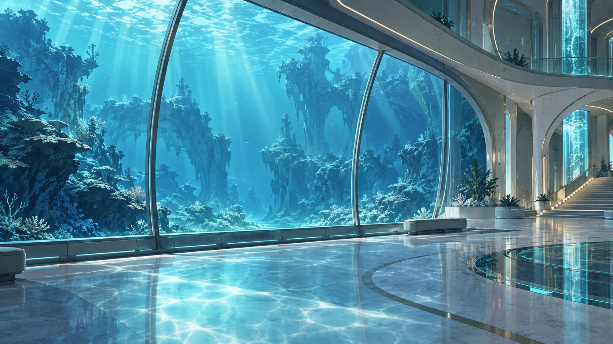

## Moonlit Rooftops

Лунные крыши Токио. Облака, ветер и огни города. Курсоры: **Lunar Wing**.

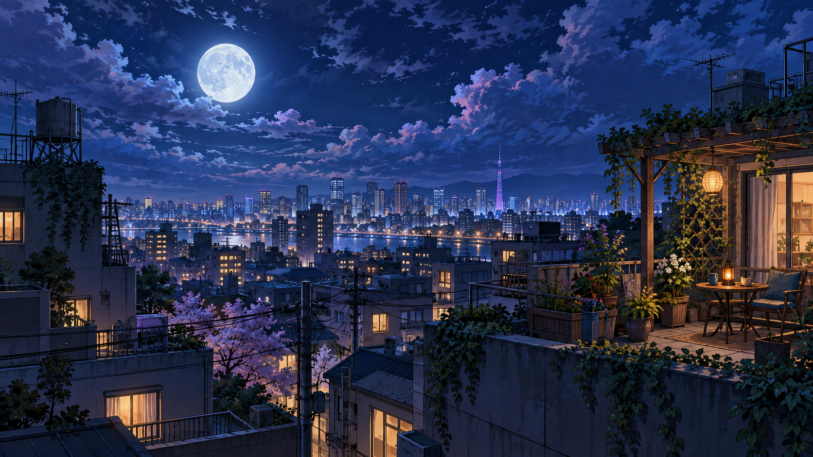

## Manga Electric

Графичный ночной город. Тушь, дождь и цветные огни. Курсоры: **Ink Stroke**.

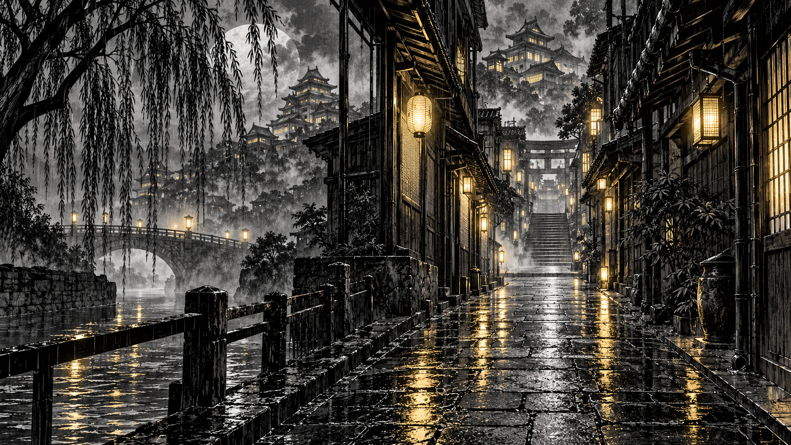

## Golden Courtyard

Золотой японский сад. Вода, светлячки и тёплые листья. Курсоры: **Amber Bamboo**.

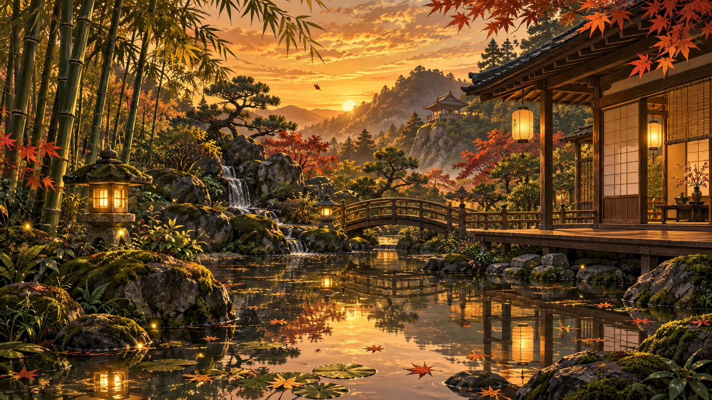
